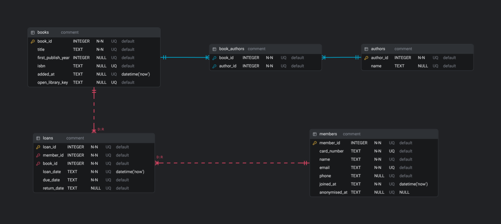

# BookClub

## 1. Overview

- The Product Goal, and the two kinds of users: members borrow and return on their own, librarians manage the catalog and members.
- A short overview of the file layout.
- Links to `CONTRIBUTING.md`, the board, and the `docs/` folder.

### 1.1 Project Goal

_Project goal and description_

### 1.2 Project Structure

_A short description of project organization_

```text
BookClub/
├── main.py
├── client.py
├── core/
│   ├── __init__.py
│   ├── database.py
│   ├── models.py
│   ├── schema.sql
│   ├── seed.py
│   └── external_api.py
├── cli/
│   ├── constants.py
│   ├── input_handlers.py
│   ├── user_session.py
│   └── ...other helpers
├── docs/
│   ├── api.md
│   ├── daily.md
│   ├── ER-diagram.png
│   └── ...other documents
├── .env.example
├── .gitignore
├── README.md
├── CONTRIBUTING.md
└── requirements.txt
```

### 1.3 Other Documents

_Explanations_ and _links_.

[How to contribute](CONTRIBUTING.md)

## 2. Setup and running (required section)

- Python 3.10 or newer, because of the type hints.
- Install `requirements.txt`.
- Copy `.env.example` to `.env` and set `API_KEY`. `.env` is ignored by Git, and each person keeps their own copy, shared privately.
- `python seed.py` builds `library.db` from `schema.sql` and fills it with test data. It refuses to run if the file exists. To reset: `rm library.db && python seed.py`.
- Run `fastapi dev main.py` in one terminal and `client.py` in another, and use `/docs` for manual testing.
- Seed prints test member cards on each run. The `LIBRARY_DB` variable (set in the shell, not in `.env`) points to another database file.
- `database.py` never creates tables.

## 3. Database design

- The ER diagram, plus why each relationship is 1:N or N:M and why it is in 3NF: `book_authors` is the junction for books and authors, and `loans` is an entity with its own dates.
- **Availability is derived** (a loan with `return_date IS NULL`), not stored, so nothing can contradict it.
- A partial unique index allows at most one active loan per book.
- One row per book, so one loan at a time. **(no copies)**
- Dates are ISO text, with `CHECK` rules for validity and order. The default loan length is 3 weeks, and it should live in one place.
- `ON DELETE` choices: a book or member with loan history cannot simply be deleted.
- `authors.name` is UNIQUE, so two real authors with the same name would merge. State it as a limitation. (**FIXIT**)
- `isbn` is TEXT without hyphens, and members and authors have a single `name` column.
- `PRAGMA foreign_keys = ON` per connection, one connection per call, and `connect()` commits once at the end so multi-step operations succeed or fail together.

### 3.1 ERD Sketch (required section)

_ASCII sketch of the ER diagram._

### 3.2 Relationships

Explaining relationships and why it is in 3NF.

### 3.3 Entity-Relationship Diagram



## 4. API

- The route list, with success codes: 201, 204(?), 404, 401, (and 409?)
- Routes under `/me` act on the member whose card is sent, and statistics live under `/stats`.
- Filters: `title`, `author`, `year`, `available`.

### 4.1 API documentation (required section)

[API documentation](docs/api.md)

## 5. Open Library

- Which fields are used and what is saved.
- A timeout on every request, a clear message when it is slow or down, and no crash.
- Handling of a missing `author_name` or `first_publish_year`.
- Which result is saved when several match. **(decide)**

## 6. Security

- `X-API-Key` on routes that change data and on routes that read personal data. If the key is missing from `.env`, everybody is refused.
- The member card goes in a header (`X-Card-Number`), never in a URL. It is random (except in the test data), made with `secrets`, capitals and digits only, and the length is 12 (at the moment).
- **Known limitations:**
  + The shared key proves "official client", not a person.
  + Anyone who has a card can act as that member.
  + There is no HTTPS on localhost and no rate limiting.
  + Librarians are identified by card: a list of librarians' cards is in the `.env` on the server.
- Roles are not stored in the database but derived based on the `X-Card-Number` provided by the client. A `role` column is possible future work.

## 7. Personal data (required section)

- **Stored:** `name`, `email`, optional `phone`, `card_number` (a credential, not personal in itself), `joined_at`, and the loan history linked to the member.
- For each column, why it is needed. **Not stored:** birth date and address, and say why.
- A reading history can reveal a lot about a person.
- `GET /me/data` shows everything held about one person.
- `DELETE /me` anonymises: it overwrites `name`, `email`, `phone` and `card_number` and sets `anonymised_at`. The loan rows stay, and the README must explain why. **(the reason, such as statistics and overdue records)**
- (Possible future work: Removing inactive members. **decide: what "inactive" means)**
- Seed data is fake (`example.com`), with no real people.

## 8. Testing and demo

- Test manually in `/docs` and in `client.py`.
- What the seed data demonstrates: at least one overdue loan, *The Hobbit* as most borrowed, books that were never borrowed, and an already anonymised member.

## 9. Not built (future work)

Reservations, extending a due date, ordering books, per-librarian accounts, hashed cards, HTTPS, and pagination, an index or a cache.
